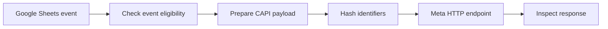

# Meta Conversions Event Routing | n8n

## The business problem

A person may click an ad, submit a form and later complete a payment. If the final outcome lives in a separate spreadsheet, marketing attribution can become incomplete. This workflow prepares structured conversion events and routes them to Meta's Conversions API.

## How it fits Heart2Heart

Grace first built the Heart2Heart landing page, implemented Google tracking and Google Ads measurement, connected Meta conversion tracking, then built lead and payment automation. This repository isolates the Meta event-routing workflow so someone can study or reuse the measurement component. See the [Heart2Heart project](https://github.com/graceomolola001-cmyk/h2h-lead-intake-and-tracking).

## Data flow

## Replicate

1. Import the sanitized workflow from `workflows/` into n8n.
2. Reconnect a fictional Google Sheet, configure your own Pixel / Dataset ID and Meta CAPI access token **privately**.
3. Review event names, timestamps, event IDs, customer-information hashing, consent and deduplication expectations.
4. Run an authorized Meta test event and inspect the HTTP response.
5. Verify the pixel and server event use consistent IDs where deduplication is intended.

## Evidence boundaries

This repository demonstrates the event pipeline. It does not contain the landing-page source, the Google Ads account, GA4/GTM configuration, live Meta secrets, verified ad-platform attribution, or campaign performance results.

Never send real personal data or production credentials in a public example.
