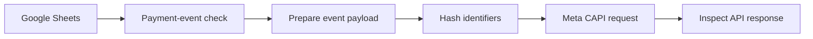

# Connecting Payment Events to Meta Ads: A Conversions API Workflow

**Meta Conversions API · n8n · Google Sheets · SHA-256 hashing · Event routing**

## The challenge

Someone discovers your programme through a Meta ad. They visit your landing page, submit their details, and complete payment later.

Your business tracker may record that final payment. But how does the advertising platform receive the eligible conversion event?

I built this workflow as part of Heart2Heart Enterprise's wider acquisition and payment-tracking system, connecting business-event data with server-side conversion measurement.

## What I built

A **seven-node n8n workflow** that checks payment-related records, prepares event information, hashes selected customer identifiers, and sends the event payload to Meta's Conversions API.

| Step | What happens | Why it matters |
| --- | --- | --- |
| **Read** | A Google Sheets trigger receives an event | Connects the business tracker to the workflow |
| **Filter** | Payment-related conditions determine whether the event should continue | Reduces unintended event sends |
| **Prepare** | JavaScript builds the event payload | Produces a predictable request structure |
| **Protect** | Crypto nodes hash designated identifiers | Supports Meta's customer-information requirements |
| **Send** | HTTP Request passes the payload to the Meta Graph API | Submits the conversion event for processing |

The goal is to report **independently verified, eligible events**, with appropriate consent and matching rules. A payment claim alone must not be treated as a confirmed purchase.

## Workflow overview

## How it fits the bigger project

I first developed Heart2Heart's landing page, then connected Google tracking and Google Ads measurement. I also implemented Meta conversion tracking and built an n8n lead and payment workflow.

This repository focuses on the **Meta event-routing component**. See the [Heart2Heart end-to-end case study](https://github.com/graceomolola001-cmyk/h2h-lead-intake-and-tracking) for the broader system.

## Explore the code

- **[Seven-node n8n export](workflows/18-meta-conversions.json)**
- **[Workflow map](docs/WORKFLOW_MAP.md)**
- **[Developer setup and tests](docs/REPLICATION_CHECKLIST.md)**
- **[Audit and known limitations](docs/REVIEW_AND_TEST_RESULTS.md)**
- **[JSON validation script](scripts/validate_workflows.py)**

## Developer quick start

1. Import the workflow into a **test** n8n instance; leave it inactive.
2. Create a fictional Google Sheet and replace the spreadsheet placeholder.
3. Configure your own authorized Meta dataset/pixel ID and access token **privately**.
4. Check event names, timestamps, event IDs, customer-data normalization and SHA-256 hashing. Use the [reproduction checklist](docs/REPLICATION_CHECKLIST.md).
5. Send a consented synthetic/test event through Meta's test tooling and inspect the response.
6. Verify browser/server event ID matching if deduplication is intended. Test invalid inputs and failure paths before enabling live events.

**Code review update:** The event builder now rejects missing lead IDs, invalid timestamps, and missing or invalid hashed identifiers. Those checks passed synthetic tests. The live Meta Graph API request, provider schema acceptance, event matching, and attribution accuracy remain **unverified**.

## What this project demonstrates

Server-side event preparation, API integration, identifier hashing, and marketing measurement automation, with attention to validation and data handling.

The public export contains no live ad-account access or verified campaign-performance figures. Use it as a documented implementation example and test it against your own authorized environment.
